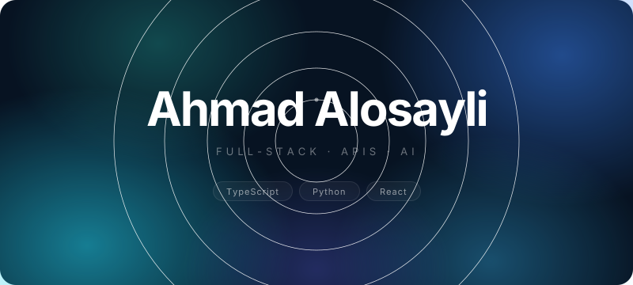

### 📈 Contributions

The contribution graph is provided by an external service and may occasionally be unavailable.

Animated header built with [readme-aura](https://github.com/collectioneur/readme-aura), adapted from the DarkOrbs template.
